# The review workflow: a manual for book review editors

This manual describes how a work offered for review becomes a published review, and what you do as the book review editor along the way. To set up the plugin, see [Setting up the plugin](setup.md).

- [The workflow at a glance](#the-workflow-at-a-glance)
- [Flowcharts](#flowcharts)
- [Step by step](#step-by-step)
  1. [Offering a work](#1-offering-a-work)
  2. [Direct reservation](#2-direct-reservation)
  3. [Bidding: choosing a reviewer](#3-bidding-choosing-a-reviewer)
  4. [When a review does not materialise](#4-when-a-review-does-not-materialise)
  5. [The review copy](#5-the-review-copy)
  6. [While the review is being written](#6-while-the-review-is-being-written)
  7. [Submission and publication](#7-submission-and-publication)
- [Keeping track](#keeping-track)
- [Reference: statuses](#reference-statuses)

## The workflow at a glance

The people involved:

- **You, the book review editor**, offer works, choose reviewers, arrange review copies and keep things moving. Each offer has one *responsible* book review editor, who receives its notifications. Journal managers can do everything you can.
- **Reviewers** find works on the public page *For review*. They reserve a work directly or apply for it, accept the review agreement and later submit their review like any other article. They need an account in the journal.
- **Publisher contacts** send review copies and, if needed, receive returned ones. They never log in. Every step they take is a one-click link in an email.

You work from the backend menu section **Objects for Review**:

- **To-do** lists everything that needs a decision or is waiting for someone. This is your starting point.
- **Available objects** lists your offers. Here you create and edit them.
- **Reviewers & bidders** lists every bidder and reviewer, with their status, due date and delivery details.
- **Reviewed works** lists works attached to review submissions.

Most steps that concern someone else come with a prefilled email that you can edit before it is sent. Everything is recorded in the offer's **history**.

## Flowcharts

### Overview

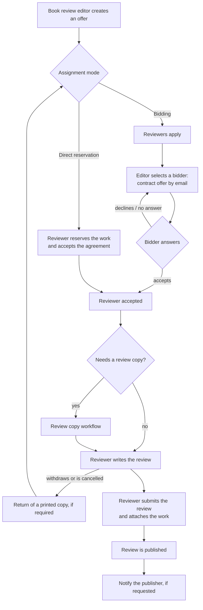

### Offer states

The state of an offer is shown on the To-do page and in the list of available objects.

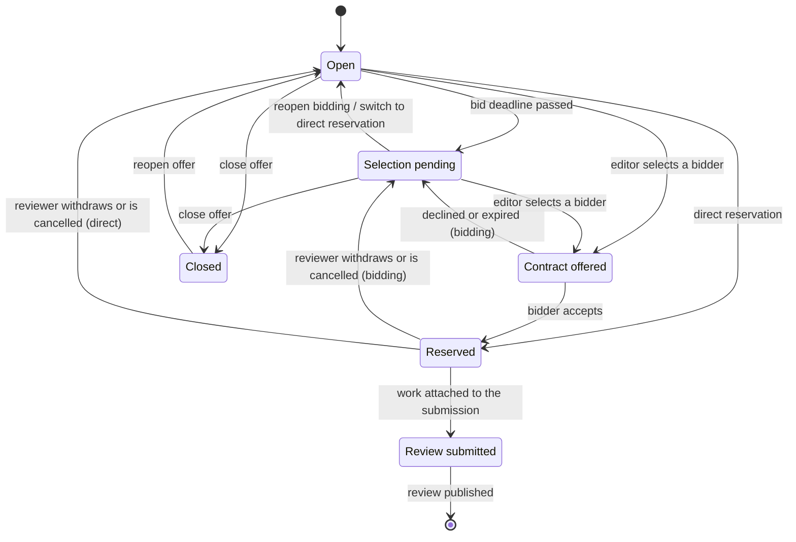

### Bidders and reviewers

Each person who applies for or reserves a work has an *assignment* with one of these statuses:

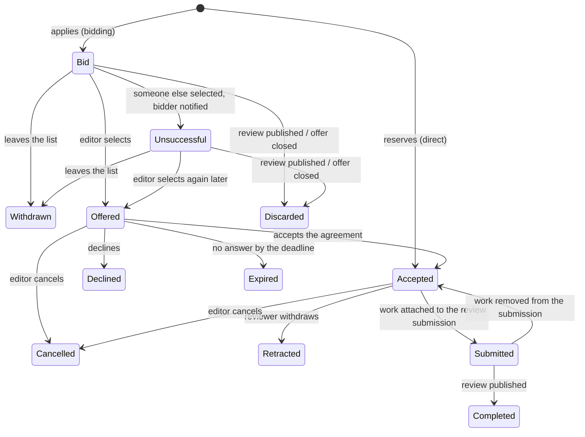

### Review copy

Only reviewers who asked for a printed or electronic copy go through this workflow. Steps marked 🔗 can also be taken by the publisher contact or the reviewer with a one-click link in their email. Each such step sends the next person their email automatically.

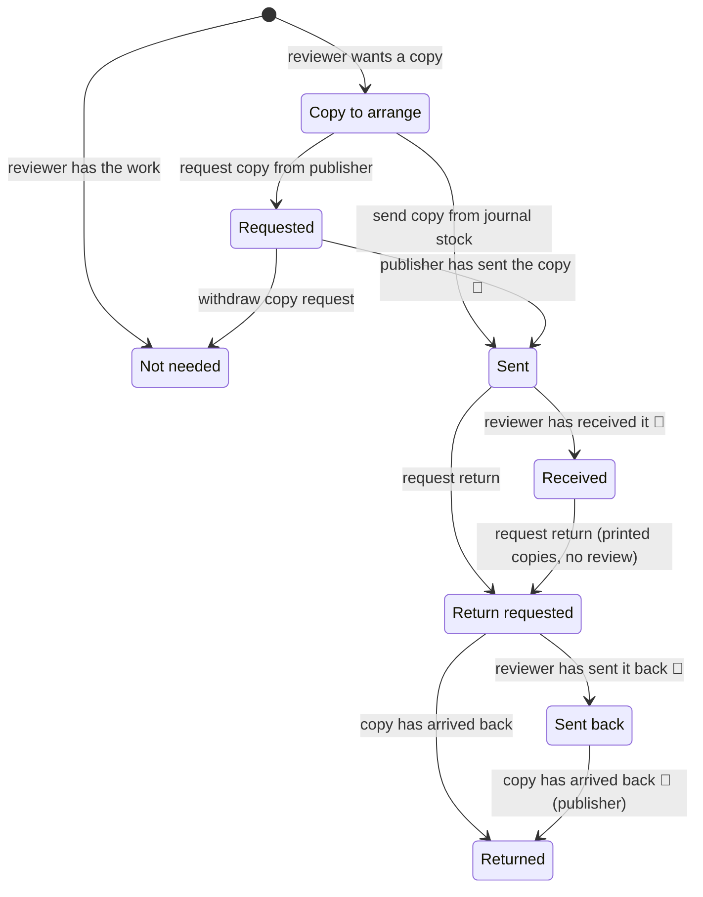

## Step by step

### 1. Offering a work

Under **Available objects › Add**, enter the work. With a DOI or ISBN, the lookup button fills in the authors, title, publisher and year.

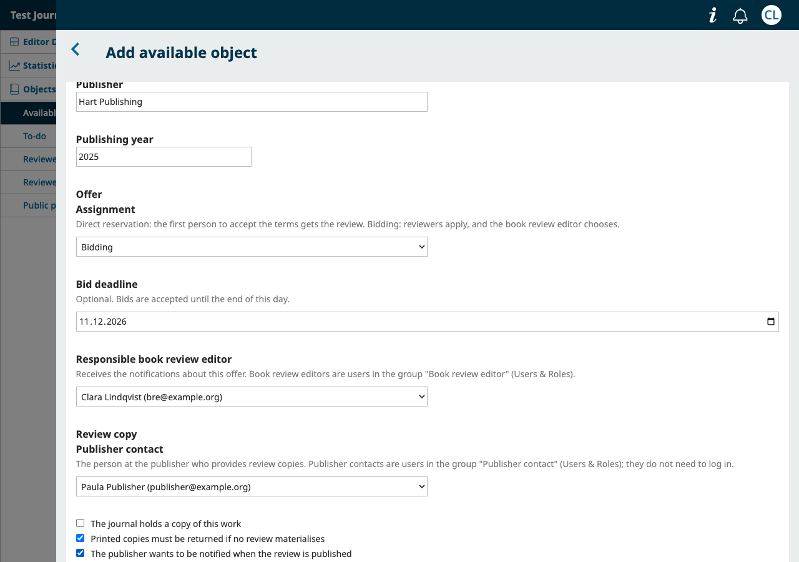

Then decide how the offer works:

- **Assignment**:
  - *Direct reservation*: the first person to accept the terms on the public page gets the review.
  - *Bidding*: reviewers apply, and you choose. The default comes from the settings.
- **Bid deadline** (bidding only, optional): applications are accepted until the end of this day. When it has passed, the offer shows "Selection pending" until you choose.
- **Responsible book review editor**: receives the notifications about this offer.
- **Review copy**:
  - **Publisher contact**: the person at the publisher who provides the copy. Without one, you can't request copies from the publisher through the plugin.
  - **The journal holds a copy of this work**: you can send it from stock. Returned copies come back to the responsible editor, so that editor needs a mailing address in their profile.
  - **Printed copies must be returned if no review materialises**: on by default. If it is off, the return step isn't offered.
  - **The publisher wants to be notified when the review is published**: adds a reminder to To-do after publication.

The work now appears on the public page and in your list of offers.

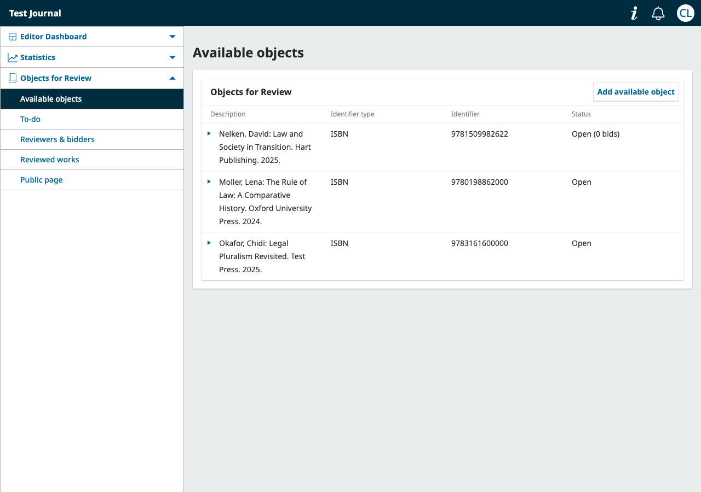

### 2. Direct reservation

On the public page, works with direct reservation show **Offer to review**, and bidding works show **Apply**. Visitors who are not logged in are asked to log in. No one sees how many people have applied.

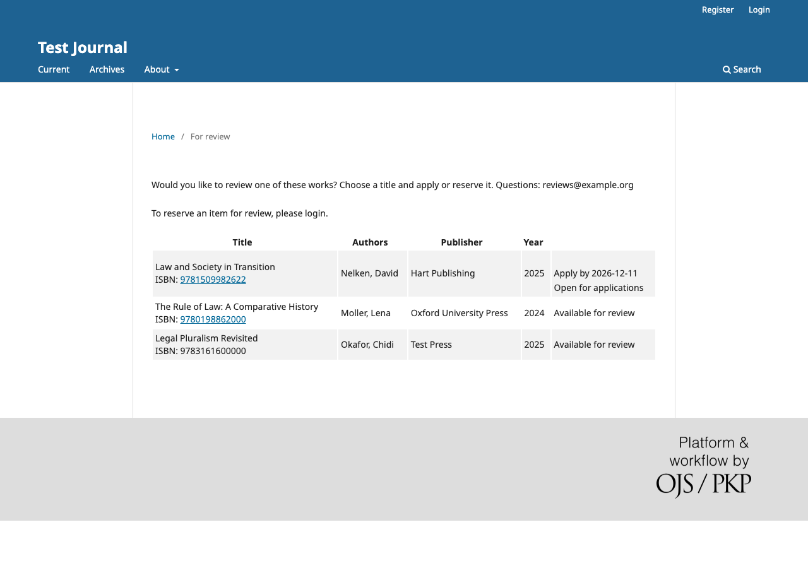

The reviewer accepts the terms of reservation, chooses a due date (within the maximum from the settings) and says how they will get the work:

- they already have it;
- a printed copy, with a shipping address and a phone number for the delivery service;
- an electronic copy;
- something else, explained in a text field.

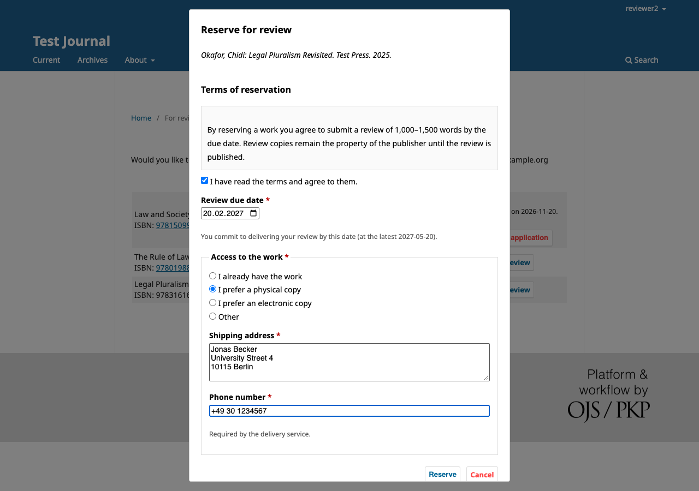

The reservation takes effect immediately. You receive a notification, the reviewer receives a confirmation, and the work shows as reserved on the public page. If the reviewer asked for a copy, it appears on your To-do page under *Review copies* (see [The review copy](#5-the-review-copy)).

### 3. Bidding: choosing a reviewer

Reviewers apply with an optional statement about their interest and expertise. You receive an email for each new application.

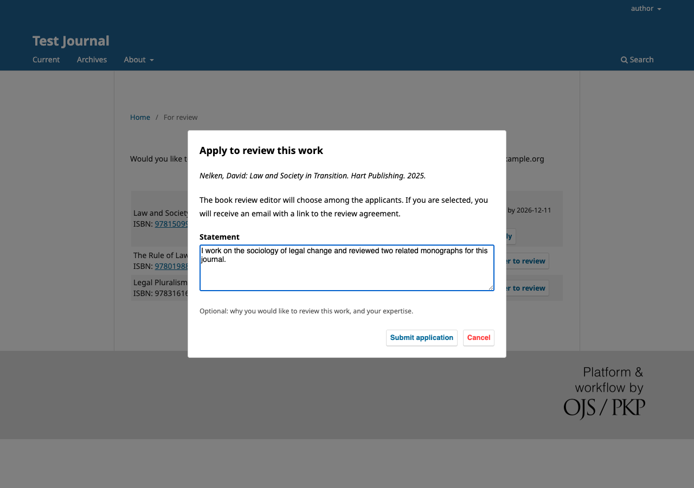

On the **To-do** page, the section *Choose a reviewer* lists each bidding offer with its applicants:

- their statements;
- their affiliation;
- how many reviews they have already written for the journal.

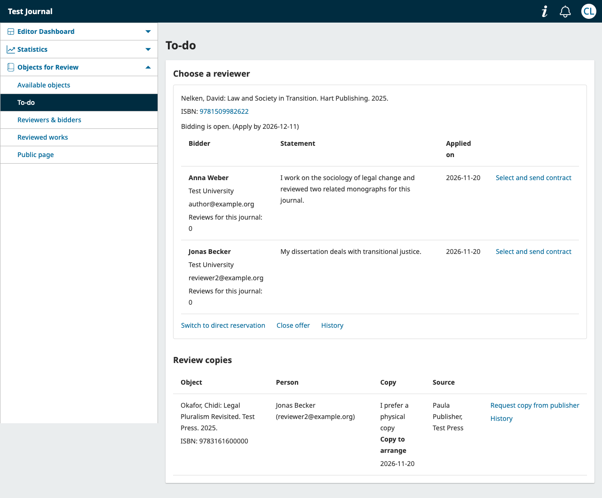

Click **Select and send contract** next to the person you choose. A prefilled email opens: the contract offer, with a link to the review agreement and the deadline for answering (14 days by default). You can edit the text. The link is added when the email is sent.

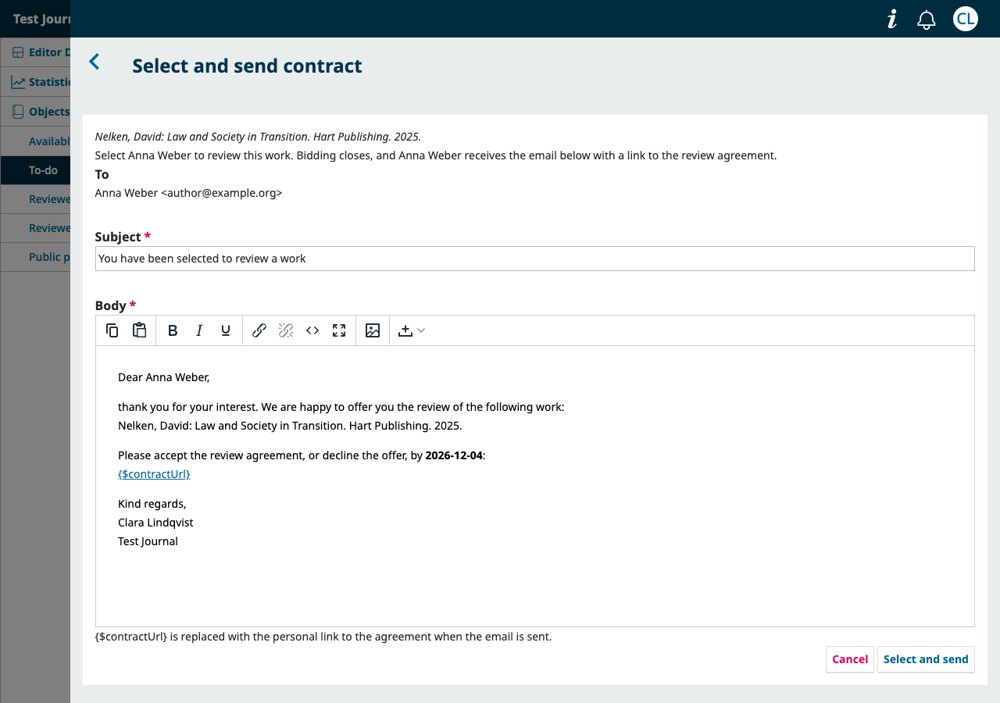

Sending it closes bidding for the offer, and the offer shows "Contract offered". The selected bidder opens the link from the email; they don't need to log in. There they accept the agreement and choose the due date and the type of copy, just as in a direct reservation. Or they tell you they can't write the review, optionally with a reason.

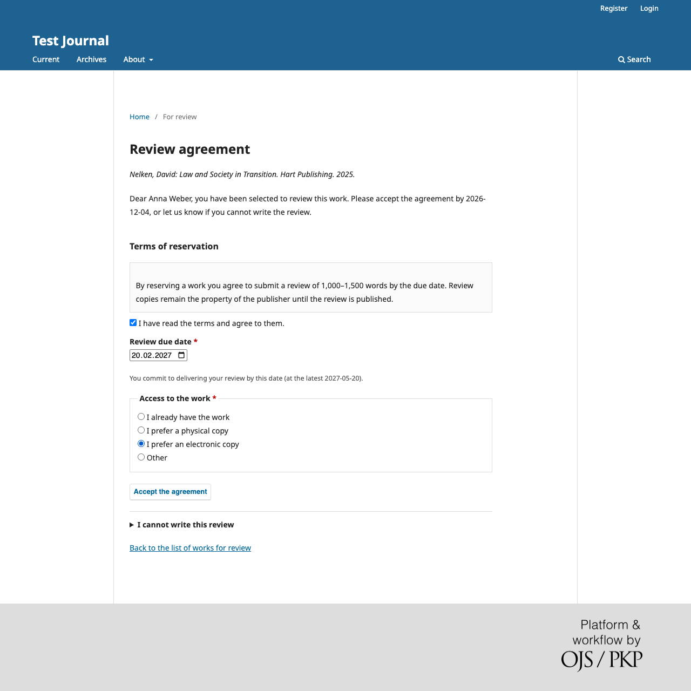

If they don't answer, they are reminded automatically (after 7 days by default). If they still don't answer by the deadline, the offer expires and you are notified.

Once the agreement is accepted, To-do shows the section **Notify bidders who were not selected**. Click **Notify bidders**: the other applicants receive an email (which you can edit) saying that someone else was chosen. They stay on the list in case the review doesn't come about, and they can remove themselves with a link in the email.

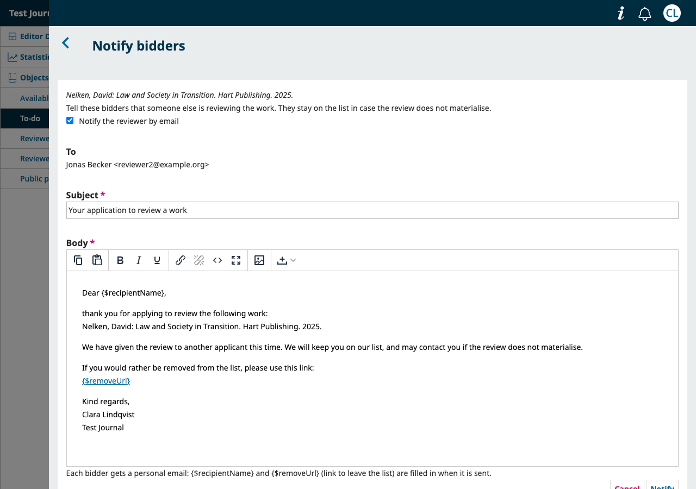

Other actions for a bidding offer, below the list of bidders:

- **Switch to direct reservation**: the first person to accept the terms on the public page gets the review.
- **Reopen bidding**: accept new applications, for example when nobody on the list is suitable. Bidders already on the list stay on it.
- **Close offer**: remove the work from the public page. The list of bidders is discarded, and their statements are deleted. You can **reopen** a closed offer later.

### 4. When a review does not materialise

A review can fall through at several points:

- the selected bidder declines the contract offer, or doesn't answer in time;
- the reviewer withdraws, on the public page or with the "I cannot write this review" link in their confirmation and reminder emails;
- you cancel the reservation, from To-do or from *Reviewers & bidders*, for example because the review is long overdue.

You are notified in each case, and the offer becomes available again:

- **Bidding offers** return to *Choose a reviewer*, with a note on what happened. The waiting list is still there. When you select someone who was already told they weren't chosen, the email uses the separate template "offer available again". You can also reopen bidding or switch to direct reservation.
- **Direct reservation offers** reappear on the public page.

If the reviewer had received a **printed copy** and the offer requires returns, the copy row on To-do offers **Request return** (see below). Copies never go directly from one reviewer to the next. They go back to the journal or the publisher first, so that reviewers' addresses are never passed on.

### 5. The review copy

When a reviewer who wants a copy has accepted the agreement, the copy appears on To-do under **Review copies**. Each row shows the reviewer, the type of copy and its current state, where the copy comes from, and the steps that are possible now.

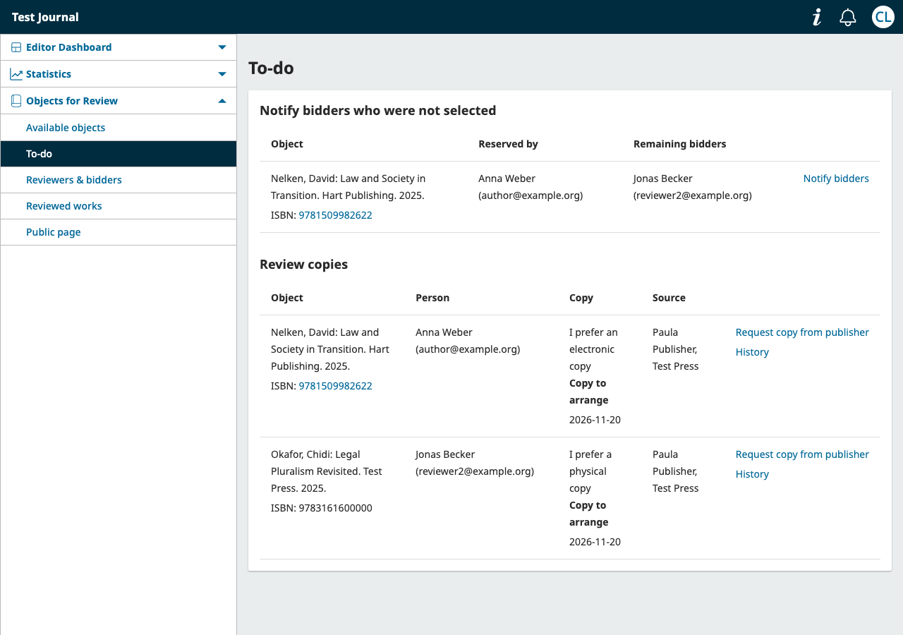

#### Getting the copy to the reviewer

1. **Request copy from publisher** (if the offer has a publisher contact). An email to the publisher contact opens, prefilled with the delivery details: the shipping address and phone number for a printed copy, the reviewer's email address for an electronic one. The reviewer's name is added automatically, so the address doesn't need to repeat it. The email contains a one-click link "I have sent the copy".

   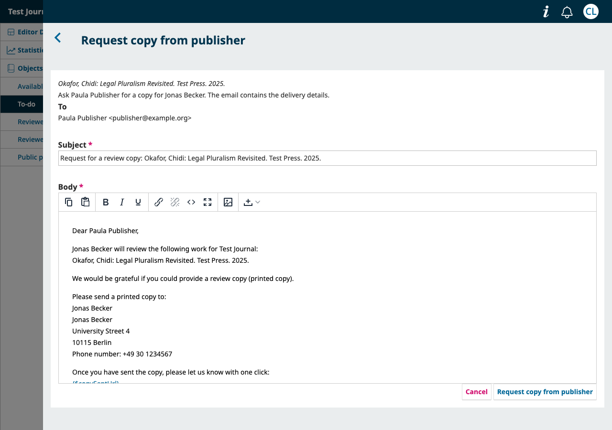

   Alternatively, use **Send copy from journal stock** if the journal holds a copy. The reviewer is told the copy is on its way, and the stock flag is cleared.
2. **The publisher has sent the copy.** The publisher confirms with the link from the email. Opening it shows a confirmation page, and only the button records the step.

   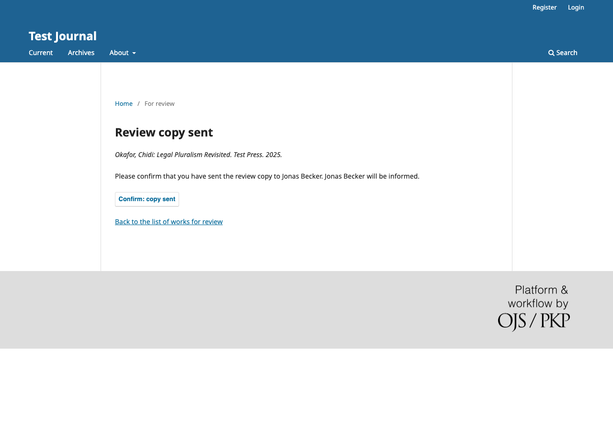

   The reviewer then receives "Your review copy is on its way", with a link "I have received the copy". If the publisher tells you some other way, record the step yourself with **Publisher has sent the copy**; the email to the reviewer is optional.

   If the publisher doesn't react, they are reminded automatically, every 14 days by default. The row shows how many reminders have been sent. **Withdraw copy request** ends the request, for example if the publisher declines.
3. **The reviewer has received the copy.** The reviewer confirms with the link, on the public page, or you record it with **Mark as received**. The delivery address and phone number are deleted at this point.

There is no return or deletion step for electronic copies.

#### Getting a printed copy back

Only if the offer requires returns and the review won't come.

1. **Request return.** Choose where the copy goes:
   - *to the journal*: the responsible book review editor's mailing address (or the journal's);
   - *to the publisher*: the publisher contact's address.

   Which is right is your call. Usually it goes back to whoever sent it. The email to the reviewer contains the address and a link "I have sent the copy back". If the reviewer still holds an active reservation, requesting the return ends it.
2. **The reviewer has sent it back.** The reviewer confirms with the link, or you record it. If the copy goes to the publisher, the publisher contact is told it is on its way, with a link "The returned copy has arrived".
3. **The copy has arrived back.** The publisher confirms with the link, or you record it with **Copy has arrived back**. A copy returned to the journal is marked as held in stock, ready for the next reviewer.

### 6. While the review is being written

- **Confirmation.** After accepting the agreement, the reviewer receives a confirmation with the work, the due date and an "I cannot write this review" link.
- **Reminder.** Before the due date (14 days by default), the reviewer is reminded automatically. The reminder contains the same link.
- **Overdue reviews.** Reviews past their due date are listed on To-do under *Overdue reviews*. From there you can email the reviewer, cancel the reservation or request the return of a printed copy.
- **Messages.** From *Reviewers & bidders* you can email any bidder or reviewer, or cancel a reservation, with an editable email.

### 7. Submission and publication

The reviewer submits the review as an ordinary submission. In the submission wizard, under *For the Editors › Objects for Review*, they pick the work they reserved. The offer then shows "Review submitted", and the reviewer's delivery details are deleted. In the editorial workflow, the review is handled like any other submission. If you are a section editor of the book review section, you can be assigned to it there.

When the review is **published**:

- the assignment is completed;
- the remaining bidders' entries are closed and their statements deleted;
- the reviewed work appears on the article page.

If the publisher asked to be notified, To-do shows the review under **Notify publishers of published reviews**. Click **Notify publisher** to send the publisher contact an email with a link to the review. You can edit the email first.

## Keeping track

**History.** Every offer has a history, which you open with **History** on To-do or in the lists. It records who did what and when, and every email sent, with its full text. Steps taken through an email link are marked "via email link"; steps taken by the daily task are marked "automatically".

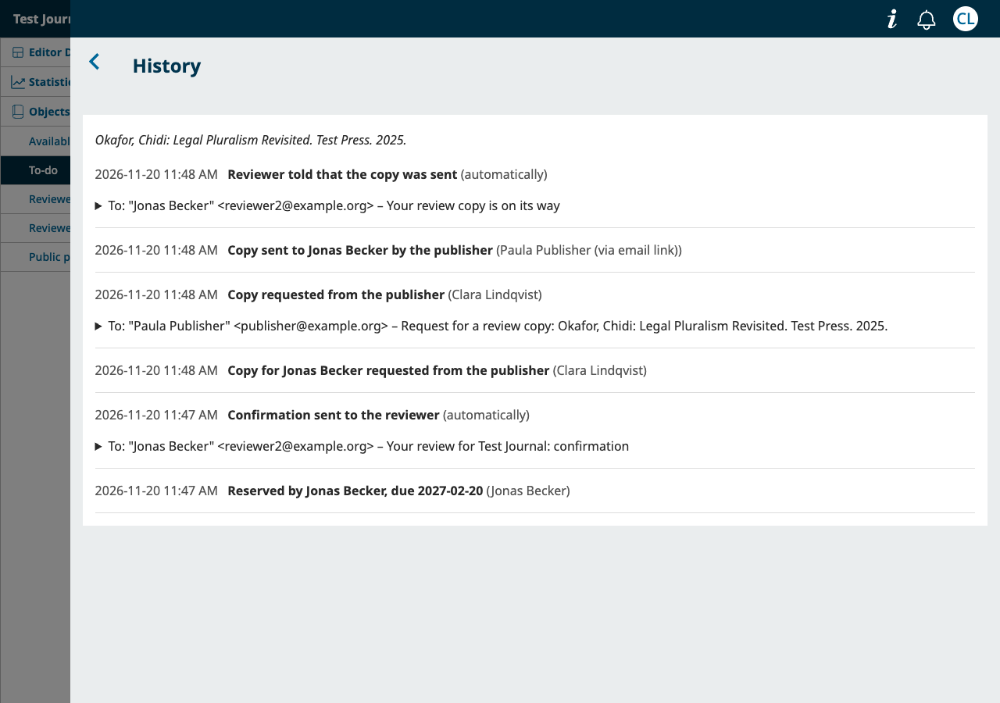

**Reviewers & bidders** lists all assignments, with a filter by status. It shows the due dates, the chosen type of copy and the delivery details (as long as they are stored), with actions to email, cancel or view the history.

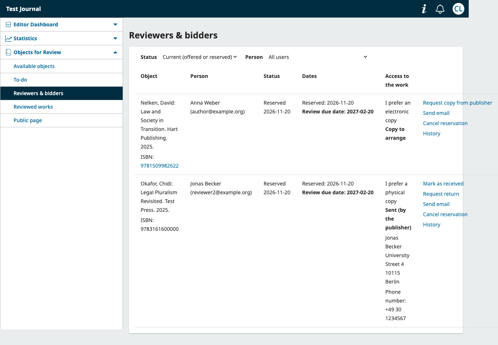

**Reviewed works** lists all works attached to review submissions.

## Reference: statuses

### Offer state

| State | Meaning |
| --- | --- |
| Open | On the public page, open for reservation or applications |
| Selection pending | Bidding has closed (deadline passed, or after a dropout); you need to choose |
| Contract offered | Waiting for the selected bidder to answer |
| Reserved | A reviewer has accepted the agreement |
| Review submitted | The work is attached to a review submission |
| Closed | You closed the offer; it is no longer public |

### Bidder or reviewer status

The labels are those shown in *Reviewers & bidders* (the flowchart above uses short names).

| Status | Meaning |
| --- | --- |
| Bid | Has applied |
| Not selected (on the list) | Someone else was chosen; still on the waiting list |
| Contract offered | Selected; waiting for an answer to the contract offer |
| Reserved | Has accepted the agreement and is writing the review |
| Review submitted | Has submitted the review |
| Review published | The review is published |
| Bid withdrawn | Left the list of bidders |
| Contract declined | Declined the contract offer |
| Contract offer expired | Did not answer the contract offer in time |
| Cancelled by the reviewer | Withdrew from the review |
| Cancelled by the editors | You cancelled the contract offer or reservation |
| List closed | Bid closed after publication or closure of the offer |

### Review copy state

| State | Meaning |
| --- | --- |
| No copy needed | The reviewer has the work, or the request was withdrawn |
| Copy to arrange | Waiting for you to request or send the copy |
| Requested from the publisher | Waiting for the publisher |
| Sent | On its way to the reviewer |
| Received by the reviewer | Arrived; delivery details deleted |
| Return requested | The reviewer has been asked to return it |
| Sent back | On its way back |
| Returned | Back with the journal or the publisher |
